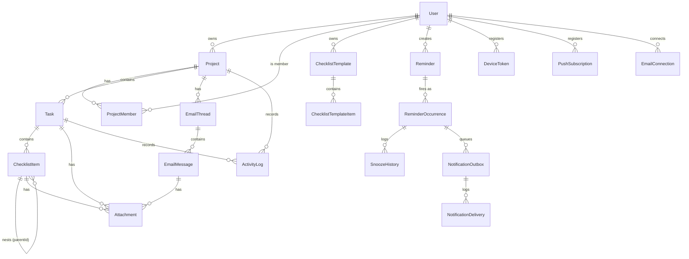

# Database Design — ProjectFlow

PostgreSQL. Full table definitions, constraints and indexes are the single source of
truth in [`apps/api/prisma/schema.prisma`](../apps/api/prisma/schema.prisma) — this
document is the readable map on top of it. Run `npx prisma migrate dev` inside
`apps/api` to generate the actual migration SQL from that schema.

## ERD (core relationships)

Note: `Reminder.entityType` + `Reminder.entityId` is a polymorphic reference to
`Project`, `Task`, or `ChecklistItem` rather than three nullable foreign keys — chosen
because a reminder engine that already has to branch on entity type for "what due date
does this relate to" gains nothing from three mutually-exclusive FKs, and the
`@@index([entityType, entityId])` keeps lookups fast. Referential integrity for *that*
link is enforced in the service layer (checked on create, and cascaded manually when an
entity is deleted) rather than a DB-level FK, which is the one deliberate deviation from
"use foreign keys everywhere" and is called out here rather than hidden.

## Key constraints worth calling out explicitly

- `NotificationOutbox.idempotencyKey` is `@unique` — the hard guarantee against
  double-sending a notification, enforced by Postgres itself, not just application code.
- `ReminderOccurrence` has `@@index([status, nextFireAt])` — the index the worker's due-
  reminder query runs on; without it that query would degrade as occurrences accumulate.
- `ProjectMember` has `@@unique([projectId, userId])` — a user can't be added twice.
- Cascades: deleting a `Project` cascades to `Task`, `EmailThread`, `ActivityLog`,
  `Attachment`; deleting a `Task` cascades to `ChecklistItem`; deleting a
  `ChecklistItem`/`Reminder` cascades to its reminder occurrences / outbox / snooze
  history, so a deleted entity can never leave an orphaned reminder still trying to fire.
- All timestamps are stored UTC (`DateTime` in Postgres is `timestamptz`); `User.timezone`
  (IANA name, e.g. `Asia/Amman`) is the only place "local time" is stored, and is applied
  at the edges (display, and computing a recurrence's next UTC instant) — never used to
  reinterpret a stored timestamp.

## Seed data

`apps/api/prisma/seed.ts` creates exactly one development user and one example project
with a couple of tasks/checklist items/reminders so the app isn't empty on first run —
no fake "production-looking" data, per the brief's instruction not to seed fake records.
